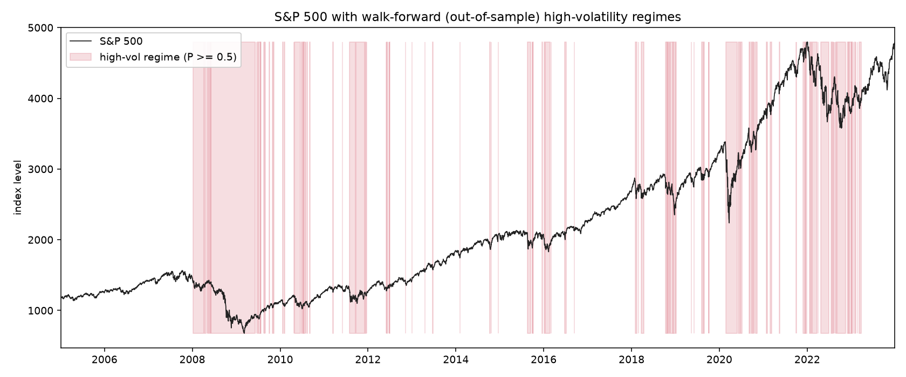
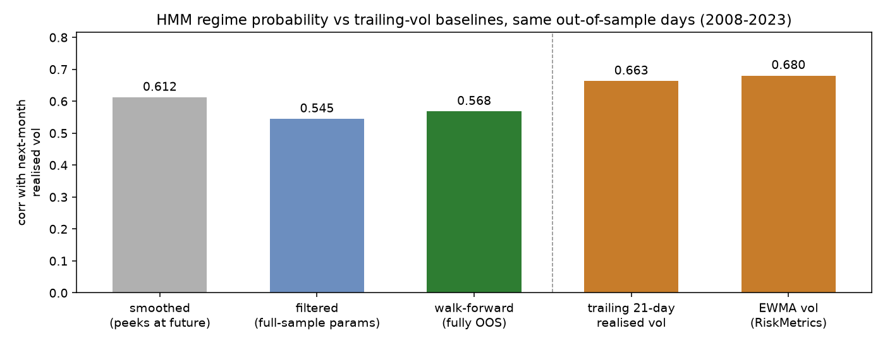
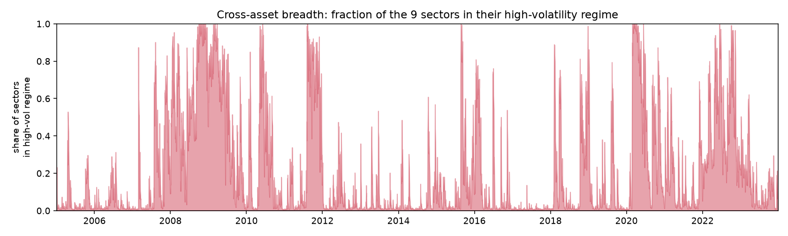
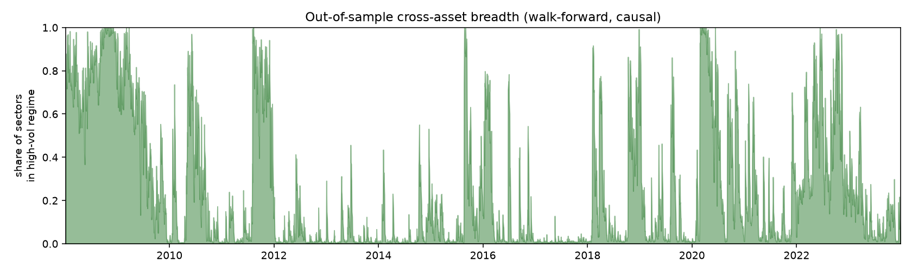
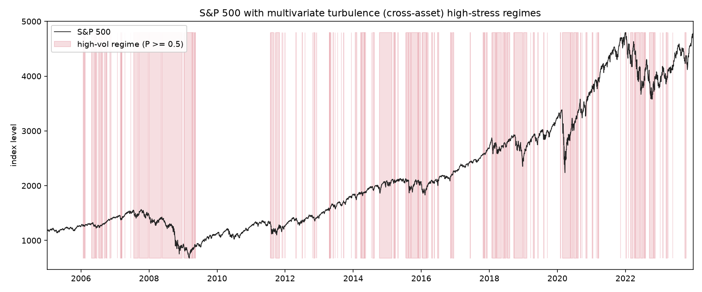
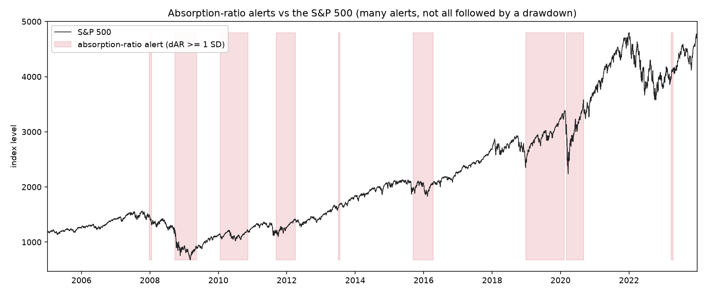
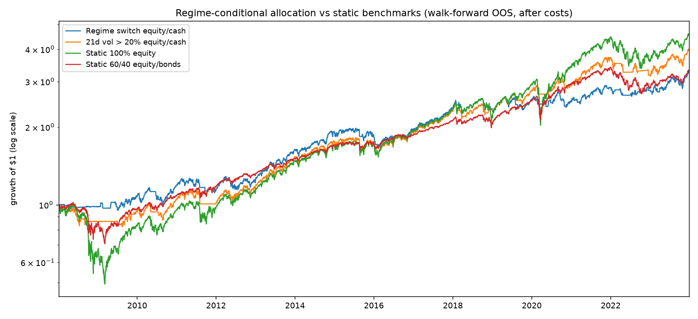
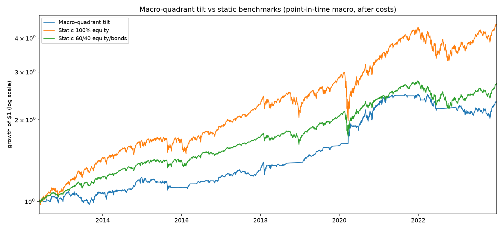
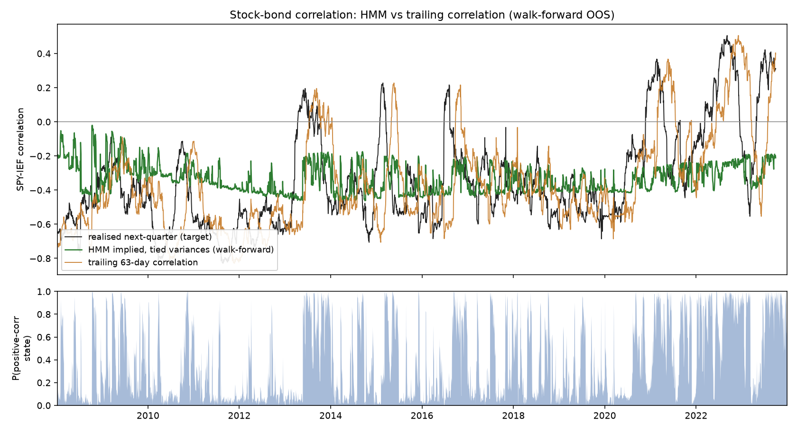
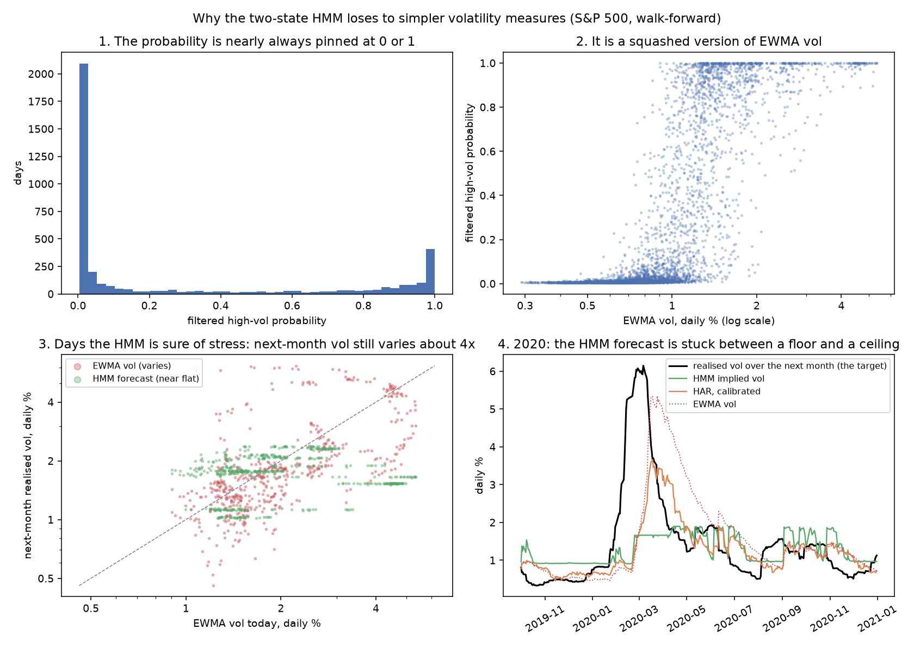

# Volatility regimes in the S&P 500, without look-ahead

Equity returns switch between calm, low-volatility stretches and turbulent, high-volatility ones.
This note fits a two-state Markov-switching model to daily S&P 500 returns to infer those states, and
then does the part most write-ups skip: it measures whether the inferred states carry real,
out-of-sample information, evaluated causally, with no future data leaking into the answer.

The headline is deliberately modest, and it has two parts. The regime signal has a correlation of
about **0.57** with next-month realised volatility, and that number **survives a strict walk-forward**
in which parameters are re-estimated on past data only and applied forward. A naive evaluation that
lets future data in reports about **0.61** on the same days. The gap between those two numbers is the
look-ahead premium. The second part is less flattering: plain trailing volatility does better at the
same test (**0.66** for 21-day realised vol, **0.68** for an EWMA), so the regime probability is not
the better volatility forecaster, and in the allocation test a simple trailing-vol switch does about
as well as the regime switch. Reporting both halves is the point.

## The model

A 2-state Gaussian Markov-switching model where the regimes differ in variance
(`statsmodels` `MarkovRegression(k_regimes=2, switching_variance=True)`), fit on daily S&P 500 log
returns from 2005-01 to 2023-12 (4,780 observations). The two states separate cleanly:

| Regime | Daily volatility | Interpretation |
|---|---|---|
| Calm | ~0.67% | low-variance, trending markets |
| Stressed | ~2.06% | high-variance, crisis-prone markets |

That is roughly a **3.1x** volatility ratio between states.

`statsmodels` was chosen over `hmmlearn` for one specific reason: it exposes both the *filtered* and
the *smoothed* state probabilities directly, and the difference between those two is the crux of an
honest evaluation.

## The trap: smoothed vs filtered

Once the model is fit, each day can be labelled two ways:

- **Smoothed** probability: P(regime | the *entire* series). It uses future returns to decide what
  today's regime was. Fine for describing history. Invalid for any forward-looking or tradeable
  claim.
- **Filtered** probability: P(regime | data *up to and including today*). Causal, and the only one
  available in real time.

A second, subtler leak hides in the *parameters*. Even filtered probabilities are contaminated if the
transition matrix and the per-regime variances were estimated using the full sample, because those
estimates saw the future too. The only way to remove that leak is to re-estimate parameters on past
data alone and apply them forward.

This is the same class of error as normalising a trading signal with the full-sample mean and
standard deviation. It looks like signal. It is hindsight.

## The honest test: walk-forward

The evaluation (`regimes.evaluate.walk_forward_oos`) runs an expanding-window walk-forward:

1. Fit the model on returns up to the current window edge (initial window: ~3 years).
2. Freeze those parameters and filter them forward over the next block (~1 quarter).
3. Keep only the filtered high-volatility probabilities on that held-out block. Each one used
   returns up to its own date and parameters estimated strictly before the block.
4. Advance by a quarter and refit.

Regimes are ordered canonically by the training window's variances, so "high-vol" means the same
thing in every block. Over 2005-2023 this produced 4,003 out-of-sample observations across 64
refits, with no fit failures. The out-of-sample span begins in 2008 because the first three years
are the initial training window.

The test itself is deliberately simple and falsifiable: does today's high-vol probability correlate
with the realised volatility of the *next* 21 trading days? If it does not, the regimes are
decorative.

## Results



The shaded periods are the model's out-of-sample high-vol regimes. They line up with the events you
would expect without being told: the 2008 crisis, the 2011 euro-area stress, the 2015-16 and late-2018
selloffs, the 2020 COVID crash, and the 2022 bear market. The calm bull runs of 2013-14, 2017 and
2021 are mostly clean. None of this shading used future data.



All three rungs are scored on the same 4,003 out-of-sample days (2008-2023). The walk-forward span
starts after its three-year training window, so the leaky rungs are restricted to those days too.
(An earlier version of this note scored the leaky rungs on the full 2005-2023 sample, 0.622 and
0.554, which mixed two different periods.)

| Evaluation | corr with next-month realised vol | What leaks |
|---|---|---|
| Smoothed (full sample) | **0.612** | future *data* |
| Filtered (full-sample params) | 0.545 | future-estimated *parameters* |
| Walk-forward (frozen params, fully OOS) | **0.568** | nothing |

Two things stand out.

First, the honest walk-forward number (0.568) is essentially equal to the filtered full-sample-params
number (0.545), and slightly higher. So in this case the parameter leak was not doing the work. If
anything, re-estimating each quarter tracks the slowly changing volatility structure a little better
than one static full-sample fit. Almost the entire look-ahead premium lives in the smoothed-versus-
causal gap, not in parameter estimation.

Second, the premium is real but small here: about **0.04** of correlation, under a tenth of the
honest signal, would have been banked as edge by a naive write-up. On a noisier target or a shorter
sample it can be much larger. The discipline matters regardless of how big it turns out to be.

## The baseline that matters: trailing volatility

A regime probability that correlates with future volatility is only worth having if it says more
than trailing volatility already does, because volatility clusters and yesterday's vol is the first
forecast anyone would try. So the same test is run on two plain baselines, on the same days and
against the same target (`regimes.evaluate.compare_vol_predictors`): trailing 21-day realised vol and
an exponentially weighted vol with the RiskMetrics decay of 0.94. Both are causal.

| Predictor of next-month realised vol | Pearson | Spearman |
|---|---|---|
| Walk-forward HMM high-vol probability | 0.568 | 0.618 |
| Trailing 21-day realised vol | **0.663** | 0.594 |
| EWMA vol (RiskMetrics 0.94) | **0.680** | **0.623** |

On the linear measure both baselines beat the regime model clearly. On ranks, which is the fairer
measure for a bounded probability against a skewed target, the three are roughly level. Adding the
HMM probability to a regression of next-month vol on trailing 21-day vol lifts the in-sample R^2 from
0.440 to 0.463, so it carries a little information that trailing vol does not, but not much.

The honest reading is that the regime model is **not a better volatility forecaster** than trailing
vol. What it adds is a discrete, persistent state with a probability attached, which is what the
allocation test further down puts to use, and that test includes the trailing-vol baseline too.
A later section ([Adding the VIX](#adding-the-vix-and-scoring-every-signal-as-a-forecast)) scores
every signal as an actual forecast against HAR-RV and the VIX, with two holdouts committed first.

## What this shows, and what it does not

This is unsupervised. There is no ground-truth regime label, so the claim is **not** "we recovered the
true regimes." The claim is narrower and testable: the inferred high-volatility state has measurable,
out-of-sample predictive content for future realised volatility, and here is how much, measured
without look-ahead. That content is real but smaller than what trailing volatility alone provides.

What it does not show:

- **The correlation itself is not a P&L.** A correlation with future realised vol is not a backtested
  profit-and-loss. The regime-conditional allocation section further down turns the signal into a
  costed position; this headline result is only a statement about predictive content.
- **Not a claim of the "right" number of regimes.** Two states is a baseline. The extensions below
  test the count by information criterion, and it holds up.
- **Fat tails matter a little.** Returns have fat tails. The extensions add both an autoregressive
  mean and a from-scratch Student-t emission as robustness checks. The regimes survive both, though
  the Student-t moves about 10% of the day-level labels (see below).

## Robustness and extensions

A set of checks and extensions on the baseline. The robustness checks confirm it rather than overturn
it, which is the point of running them. Reproduce with `python examples/extensions.py`.

### How many regimes?

Fitting the model for two, three and four states on the full S&P 500 sample:

| States | AIC | BIC | Converged |
|---|---|---|---|
| 2 | 13203 | 13242 | yes |
| 3 | 12702 | 12780 | **no** |
| 4 | 12668 | 12798 | **no** |

The three- and four-state fits report lower information criteria, but they **fail to converge**: the
optimiser cannot identify a stable third or fourth state on this data, so those numbers are not
trustworthy. Among the fits that actually converged, both AIC and BIC select **two states**. The
baseline count is the honest choice, not an assumption. (This is exactly why the `converged` flag is
reported and non-converged fits are excluded from the selection rather than silently ranked.)

### Systemic or sector-specific? Cross-asset concordance

Fitting the same two-state model independently to each of the nine SPDR sector ETFs, the high-vol
regimes move together: the mean pairwise correlation of the sectors' high-vol probabilities is
**0.66**. Volatility stress is largely a systemic, market-wide state rather than a sector story.

"Breadth", the share of the nine sectors in their high-vol regime, makes this visible. It sits near
zero in calm periods and saturates to all nine sectors during 2008-09, 2011, the 2020 COVID crash and
2022.



The figure above fits each sector on the full sample, so it is descriptive. Running the same idea
through the walk-forward machinery instead - each sector's high-vol probability comes from
`evaluate.walk_forward_oos`, so it used only past data and past-estimated parameters - gives a breadth
gauge you could have computed in real time. The systemic story survives the stricter test: the
out-of-sample mean pairwise correlation is **0.67**, essentially unchanged from the descriptive 0.66,
and the crisis structure is the same.



### Robust to an autoregressive mean?

The baseline assumes returns are i.i.d. within a regime. Adding an AR(1) mean
(`MarkovAutoregression`) lets the model separate "high variance" from "momentum". The regimes barely
move: the AR and baseline high-vol probabilities correlate at **1.00** and agree on the high-vol
classification on **99.3%** of days. The regimes are a volatility phenomenon, not an artefact of
ignoring autocorrelation.

### Robust to fat tails? Student-t emissions

Equity returns have heavier tails than a normal, and this is the failure mode worth taking seriously:
a Gaussian model can invent a spurious high-variance state just to accommodate a few outliers that a
fat-tailed distribution would absorb within one regime. statsmodels only offers Gaussian switching
models, so this variant (`regimes.student_t.fit_regimes_student_t`) is implemented from scratch: a
Markov-switching model with Student-t emissions, fit by EM using the scale-mixture representation of
the Student-t so outliers are down-weighted in closed form. Its correctness is checked by a test that
confirms it reproduces the statsmodels Gaussian fit as the degrees of freedom grow.

With nu = 5 (heavy tails), the fat-tailed regimes correlate at **0.92** with the Gaussian baseline and
agree on the high-vol classification on **90%** of days. So the regimes are mostly robust to fat
tails, but not entirely: the Student-t reclassifies about one day in ten. That is the expected
direction: some days the Gaussian labelled high-vol were isolated outliers, which the Student-t keeps
in the calm regime rather than treating as a change of state. This is the most informative of the
robustness checks, because it actually moves something, and in the way the theory predicts.

The degrees of freedom can also be estimated rather than fixed (`estimate_nu=True`), via an EM update
that solves the digamma equation for nu each iteration. On the S&P 500 the estimate is **nu = 4.75**,
genuinely heavy tails, and close enough to the nu = 5 used above that the fixed choice was a fair one.
It is offered as an option rather than the default because the nu likelihood is famously flat, so a
fixed, documented value is the more honest robustness setting.

## Multivariate regimes: a Financial Turbulence input

Everything above defines regimes from a single asset's returns. Real systematic funds do not: they use
a multivariate stress measure. The canonical one is **Financial Turbulence** (Kritzman & Li 2010) - the
Mahalanobis distance of the day's cross-asset return vector from its history,
`FT = (r - mu)' Sigma^-1 (r - mu)`, which fires both on uncharacteristically large moves and on breaks
in the cross-asset correlation structure. Feeding that series into the same 2-state HMM ("normal" vs
"ex-normal") is standard practice among systematic managers (Kritzman & Li 2010).

The implementation (`regimes.turbulence`) computes turbulence across the nine SPDR sectors with the
mean and covariance estimated causally from a trailing window, so it inherits the same look-ahead
discipline as the rest of the repo, and fits the HMM ordered by mean turbulence (normal vs ex-normal).

The honest comparison, on the S&P 500 (2005-2023):

| Regime signal | corr with next-month S&P 500 realised vol |
|---|---|
| Single-asset S&P 500 volatility regime | 0.55 |
| Multivariate turbulence regime (9 sectors) | 0.39 |

(Both are computed on a full-sample fit here, for a like-for-like comparison; the single-asset 0.55 is
the filtered full-sample-params number from the ladder above, not the 0.57 walk-forward headline.)

The turbulence regime is a genuinely *different* signal - it agrees with the single-asset labelling on
only 74% of days. And it scores **lower** on predicting the S&P 500's own next-month volatility. That
is expected, not a failure: the single-asset model is almost tautologically tied to S&P 500 vol because
it is built from it, whereas turbulence measures broader cross-asset fragility that a single-asset model
cannot see. Its value is as a systemic-stress gauge and, per the literature, as an input to
regime-conditional *allocation* across assets - not as a sharper predictor of one index's volatility.
Testing it on that narrower task is the fair, unflattering comparison, so that is the one reported here.



## The Absorption Ratio, and its false-alarm rate

The Absorption Ratio (Kritzman, Li, Page & Rigobon 2011) is the fraction of a cross-section's total
return variance absorbed by its first few principal components. A high AR means risk is concentrated
in a few factors, i.e. markets are tightly coupled and fragile. The early-warning signal is a
standardised shift `dAR = (AR_short - AR_long) / sigma(AR_long)`, with a one-standard-deviation spike
as the trigger; all inputs are trailing, so it is causal (`regimes.absorption`).

The papers report that essentially all major drawdowns were *preceded by* an AR spike. That is a
**recall** statistic, and on its own it is not an edge: it says nothing about how often a spike fires
with no drawdown following. So the repo measures the full confusion matrix. On the S&P 500
(2005-2023), alert = one-SD dAR spike, outcome = a drawdown of at least X% within the next 21 trading
days:

| Outcome | recall | precision | false-alarm share | base rate | lift |
|---|---|---|---|---|---|
| drawdown >= 5% | 0.32 | 0.24 | **0.76** | 0.18 | **1.37** |
| drawdown >= 10% | 0.43 | 0.08 | **0.92** | 0.05 | **1.82** |

("False-alarm share" here is the fraction of alerts *not* followed by a drawdown, i.e. 1 - precision,
which is the false-discovery rate rather than the classical false-positive rate FP/(FP+TN); the code
reports both.)

The honest reading: the AR spike carries a **real but modest** edge (lift of 1.4 to 1.8 times the base
rate, and it is larger for the more severe drawdowns, which is the right direction), but **76% to 92%
of alerts are false** and alerts fire on ~23% of all days. "Almost every drawdown was preceded by a
spike" and "most spikes are false alarms" are both true at once, and only the first half survives into
the marketing. Reporting the false-alarm rate and the lift is the contribution here.



Caveats, stated plainly: this uses the 9 SPDR sectors, so only ~2 principal components (n/5), a much
coarser cross-section than Kritzman's 51 industries with 10 components; the recall here is therefore
far below the paper's near-100%, partly from the smaller universe and a different drawdown definition.
This is not a refutation of the paper. It is the missing half of the picture: even taking the leading-
indicator claim at face value, the signal is a high-false-alarm one with a genuine but small lift.

## Regime-conditional allocation: holding the signal to a P&L standard

Everything so far measures a regime signal against volatility. The literature (Ang & Bekaert 2004) is
clear that the actual value of regime detection shows up somewhere else: not in predicting one index's
volatility, but in switching across assets to avoid losses. So this is the capstone test - turn the
regime probability into a position and score it on profit and loss.

The rules are deliberately strict on look-ahead: the regime probability is the **walk-forward
out-of-sample** one (parameters estimated only on past data), the position for each day is decided from
the prior day's information, and turnover is charged 5 basis points. When the filtered high-vol
probability is below 0.5 the strategy holds equity (SPY); at or above it, the strategy switches to cash
(BIL) or to 7-10y Treasuries (IEF). Benchmarks are static 100% equity, a static 60/40, and the
baseline from earlier: the same equity/cash switch driven by plain trailing vol instead of the regime
model, moving to cash when annualised vol is at or above 20%. The 20% is a round number fixed in
advance, not tuned. A volatility-targeting rule is included as the standard continuous alternative
(Moreira & Muir 2017 style, no leverage): equity weight = 10% / EWMA vol, capped at 1, the rest in
cash. Window: 2008-2023 (where the OOS signal exists).

| Strategy | ann return | ann vol | Sharpe | max drawdown | Calmar |
|---|---|---|---|---|---|
| Regime switch equity / cash | 7.7% | 10.9% | 0.66 | **-15%** | **0.51** |
| Regime switch equity / bonds | 8.5% | 12.0% | 0.67 | -17% | 0.51 |
| 21-day vol > 20%, equity / cash | 9.1% | 11.6% | **0.74** | -18% | **0.51** |
| EWMA vol > 20%, equity / cash | 6.7% | 11.6% | 0.55 | -20% | 0.33 |
| EWMA vol target 10%, equity / cash | 7.0% | 10.0% | 0.65 | -19% | 0.37 |
| Static 100% equity | **10.0%** | 20.4% | 0.53 | -51% | 0.19 |
| Static 60/40 equity / bonds | 7.8% | 11.6% | 0.64 | -31% | 0.25 |



The honest reading, and it is exactly what the literature predicts. Regime switching **does not make
more money** than buy-and-hold equity - it earns less (7.7% vs 10.0%), because sitting out flagged
periods means missing some of the rebounds. What it does is earn a similar amount with **half the
volatility and a third of the drawdown**: max drawdown falls from -51% to -15%, and risk-adjusted
return improves clearly (Sharpe 0.66 vs 0.53, Calmar 0.51 vs 0.19). The chart shows where it comes
from: the regime strategies sidestep almost all of 2008 and most of 2020, and give the ground back
slowly during the long bull run. This is loss avoidance, not alpha, and it is the value Ang & Bekaert
attribute to regimes.

Two comparisons take most of the shine off that. Against a static 60/40, which is the fairer
benchmark for a strategy that spends a quarter of its time in cash, the Sharpe gain is 0.02 (0.66 vs
0.64), and what remains is the smaller drawdown (-15% vs -31%). And against the trailing-vol switch,
the regime model is not clearly better: the 21-day rule has a higher Sharpe (0.74) and a slightly
deeper drawdown (-18%), the EWMA rule a lower Sharpe (0.55). The threshold grid printed by the script
shows the trailing-vol rules spread across roughly the same range as the regime switch:

| Trailing-vol rule, equity / cash | 15% | 20% | 25% |
|---|---|---|---|
| 21-day vol: Sharpe / max drawdown / days in cash | 0.63 / -12% / 44% | 0.74 / -18% / 24% | 0.72 / -25% / 14% |
| EWMA vol: Sharpe / max drawdown / days in cash | 0.61 / -15% / 44% | 0.55 / -20% / 24% | 0.67 / -21% / 13% |

(The regime switch spends 28% of days in cash.) Six variants on one path is a small grid, and picking
its best cell would be the same mistake as reporting a smoothed label, so the reading is about the
range: on this sample the regime model does about as well as a plain trailing-vol rule, not better.

**None of these Sharpe ratios can be told apart on this sample.** A paired circular block bootstrap
(`regimes.allocation.block_bootstrap_sharpe`: quarter-long blocks to keep volatility clustering, the
same blocks for every strategy so differences are paired, 2,000 draws) gives:

| Strategy | Sharpe 95% interval | Sharpe minus regime switch (equity/cash), 95% interval |
|---|---|---|
| Regime switch equity / cash | 0.24 to 1.11 | |
| Regime switch equity / bonds | 0.26 to 1.09 | -0.17 to +0.19 |
| 21-day vol > 20% | 0.31 to 1.18 | -0.19 to +0.31 |
| EWMA vol > 20% | 0.09 to 1.03 | -0.40 to +0.17 |
| EWMA vol target 10% | 0.23 to 1.09 | -0.32 to +0.28 |
| Static 100% equity | 0.13 to 1.03 | -0.58 to +0.29 |
| Static 60/40 | 0.22 to 1.15 | -0.51 to +0.42 |

Every difference interval contains zero, including the one against plain buy-and-hold. Sixteen years
of daily data pins a single Sharpe ratio down only to about plus or minus 0.4, while the gaps in the
table are under 0.2, so the Sharpe column above should be read as a description of one path rather
than a ranking. The drawdown reduction is the more robust part of the result, since every switching
and vol-targeting rule cuts the maximum drawdown sharply (-12% to -25%, against -51% for equity),
though as a single-path statistic it has no interval here either.

Caveats, because this is the result most easily oversold. It is a single out-of-sample path on one
market over one 16-year window, and that window is bracketed by two large crashes that flatter a
loss-avoidance strategy; a different sample could look very different (Ang & Bekaert flag the same
sample-specificity about their own numbers). The binary switch is crude, the ~2.3% of annual return
given up is a real cost of the insurance, and none of this is a live trading system. The claim is
narrow: used the way the literature says to use it, the regime signal produces a genuine,
out-of-sample, cost-aware reduction in drawdown, and on this sample a plain trailing-vol switch
achieves about the same.

## Macro growth/inflation quadrants, and the cost of doing it honestly

The last piece follows Bridgewater and Kritzman-Page-Turkington: classify each day by two macro
drivers, growth and inflation, each rising or falling, into a four-quadrant regime (goldilocks,
overheating, stagflation, slowdown), and tilt allocation by each quadrant's asset bias. Growth is the
Chicago Fed CFNAI activity index, inflation is core-CPI year-over-year (`regimes.macro`).

For this repo the interesting part is not the 2x2, it is the data. Macro series are published weeks
after their reference period and then revised, so a naive pull feeds the model numbers that did not
exist at decision time. The implementation therefore uses **point-in-time** data from FRED/ALFRED:
first-release values, indexed by their actual publication date (`realtime_start`) rather than their
reference date, forward-filled onto the daily grid. Nothing enters the series before the day it was
really released.

Doing this honestly has a price that is itself the headline finding. ALFRED's real-time (vintage)
archive for the CFNAI only begins in **May 2011**, even though the index itself runs back to 1967. So
the honest, look-ahead-free macro series only exists from 2011, and after the trailing-trend warmup the
usable backtest starts in **2012**. Using the revised series would buy a longer history at the cost of
look-ahead, which is exactly the trade this repo refuses. Integrity costs years of sample here, and
that is worth stating rather than hiding.

The result, 2012-2023, quadrant tilt across equity/bonds/cash vs static benchmarks, after costs:

| Strategy | ann return | ann vol | Sharpe | max drawdown | Calmar |
|---|---|---|---|---|---|
| Macro-quadrant tilt | 7.5% | 9.4% | 0.72 | -19% | 0.40 |
| Static 100% equity | 13.8% | 16.9% | 0.80 | -34% | 0.41 |
| Static 60/40 equity/bonds | 9.0% | 9.9% | 0.82 | -21% | 0.43 |

This one does **not** work, and the honest thing is to say so. The quadrant tilt trails both benchmarks
on return and on Sharpe (7.5% and 0.72, versus 9.0% and 0.82 for a plain 60/40 and 13.8% and 0.80 for
all-equity). It does cut drawdown versus all-equity, to about the level of a plain 60/40 (-19% vs
-21%), but 60/40 delivers that same risk reduction with clearly higher return and Sharpe, so the tilt
adds nothing a static balanced fund did not. Two reasons, both anticipated when the feature was scoped. First, the usable window (2012-2023) is short and
almost entirely a bull market, so a strategy that sits in cash or bonds for roughly half the days -
every "stagflation" and "slowdown" quadrant - simply misses equity gains. Second, a monthly macro
signal is a slow, coarse overlay, and macro regimes turn over so rarely that a decade contains only a
few independent observations. The macro-quadrant layer is a descriptive allocation tilt on a sample too
small and too one-directional to add value here, and that is a more useful thing to have demonstrated
than another flattering backtest.



(Tier 2 - full ALFRED vintage reconstruction via `get_series_as_of_date`, and survey-based expectations
- is documented in `regimes/macro.py` as the rigorous upgrade, but it would not change the sample-size
limitation that drives this result.)

## Stock-bond correlation regimes: aiming the HMM at a state that is actually hidden

The volatility results above have a simple explanation. Volatility is close to observable, since a
few large daily moves reveal it within days, so a hidden-state model mostly rebuilds what trailing
volatility already shows, more coarsely. The sign of the stock-bond correlation is a better
candidate for a hidden state: it was positive through the 1970s to 1990s, negative for most of
2000-2021, and positive again from 2022, and daily cross-products are noisy enough that a trailing
correlation needs a long window to settle. So the last experiment points an HMM at it
(`regimes.correlation`).

**Design.** Equity and Treasury returns are each divided by their own EWMA volatility from the
previous day, so that what is left to separate the states is mostly correlation. A two-state HMM
with a full-covariance Gaussian per state is fit by EM, walk-forward with quarterly refits and
frozen parameters filtered forward, exactly as for the volatility model. Its forecast is the
implied correlation over the next quarter. The baselines are trailing 63-day and 252-day
correlation and an EWMA correlation, the target is the realised correlation over the next 63 days,
and everything is scored on the same days.

### Development period, 2005-2023 (SPY and IEF)

The pre-registered model **failed outright**. Maximum likelihood preferred to spend both states on
short volatility shocks that survive the devolatilisation (one state with about 2.5 times the
variance, lasting about two days on average), and the two states ended up with almost the same
correlation (-0.35 and -0.27). A clean correlation split (-0.61 and +0.13) does exist, and plain EM
from a neutral start finds it, but it has a lower likelihood by about 100 log-likelihood units, so
the walk-forward correctly moved past it. Restarting each refit from a fresh start did not change
this. The implied correlation came out *negatively* related to the outcome (-0.31).

A second variant was then added, with the variances tied across states so that they can differ only
in correlation. Its states separate as intended (-0.59 and +0.14), but as a forecast of the
correlation level it still loses to trailing correlation (RMSE 0.286 against 0.272, interval
spanning zero), for the same reason as the volatility model: two discrete levels cannot track a
continuous quantity. Its probability of the positive state did turn positive on 25 Jan 2021, a month
before the trailing 63-day correlation, but that is one flip, and once false alarms were counted it
switched sign 19 times against 10 for the trailing correlation.



### Holdout, 1962-2004, run once

Two variants had been chosen after looking at 2005-2023, so a win there would be partly fitted to
it. The rules for a holdout on 1962-2004, which neither model had seen, were therefore written and
committed first ([HOLDOUT_PROTOCOL.md](HOLDOUT_PROTOCOL.md), commit `53b50c6`), and the holdout was
run once. ETF bond data starts in 2002, so the bond leg is a 10-year Treasury return proxy built
from the FRED DGS10 yield (carry plus duration times yield change). On 2005-2023 its quarterly
stock-bond correlation matches the IEF version at 0.990.

Level forecast, 9,878 days (1965-2004):

| Signal | corr with outcome | RMSE | RMSE minus trailing 63-day, 95% interval |
|---|---|---|---|
| HMM, unconstrained | 0.05 | 0.321 | +0.034 to +0.109, **worse** |
| HMM, tied variances | 0.08 | 0.329 | +0.045 to +0.111, **worse** |
| Trailing 63-day correlation | 0.65 | 0.251 | |
| Trailing 252-day correlation | 0.65 | 0.237 | -0.034 to +0.006, no difference |
| EWMA correlation (0.97) | **0.68** | 0.239 | -0.019 to -0.005, **better** |

Regime detection. The frozen definition (runs of one sign lasting at least 126 days) finds only
three lasting flips in 40 years, all between 1998 and 2000; the 1970s-1990s positive regime is one
long run. Each signal's sign call switches only after 21 days of the new sign and is dated on the
day it could have been known:

| Signal | lags in trading days (3 flips) | median | misses | false alarms |
|---|---|---|---|---|
| HMM tied, P(positive state) | 143, 49, 0 | 49 | 0 | 6 |
| Trailing 63-day correlation | 0, 83, 0 | 0 | 0 | 18 |
| Trailing 252-day correlation | 98, 188, 38 | 98 | 0 | 5 |
| EWMA correlation (0.97) | 0, 98, 0 | 0 | 0 | 17 |
| HMM implied correlation (either variant) | 0 | 0 | 2 | 1 to 5 |

A lag of 0 means the signal already showed the new sign on the flip date, which can come from an
earlier switch during a shorter run of the same sign.

**Verdict under the frozen rule: the HMM adds nothing.** Both variants are significantly worse than
trailing correlation at forecasting the level, and the tied classifier is slower than the trailing
63-day correlation (median 49 days against 0) while having fewer false alarms (6 against 18), which
fails the rule that required it to be no worse on all three counts. Outside the rule, and on only
three events, it sits on the speed versus false-alarm trade-off about where a trailing window
between 63 and 252 days would, so even that is not something a simpler signal cannot do.

The one result that held on both periods is a plain one: the EWMA correlation beat the trailing
63-day correlation on level in 2005-2023 and again in the holdout.

What this does and does not show. It shows that this HMM, as specified, has no edge over simple
correlation estimates on this question, on 60 years of data, with the decisive test run once on
unseen data. It does not show that no regime model can help here. A Student-t multivariate
emission, which could absorb shocks without spending a state on them, is the obvious untried next
step, and three flips is still a small number of events. Two variants were tried in total, and both
are reported.

## Adding the VIX, and scoring every signal as a forecast

Everything above scores the regime model with a correlation, which says whether it ranks future
volatility well but not whether it forecasts it accurately. This section turns every signal into an
actual forecast of next-month realised volatility and scores them all on the same days, with RMSE and
with QLIKE, the standard loss for volatility forecasts, which punishes under-forecasting harder than
over-forecasting. It also brings in two things the earlier sections lacked. One is HAR-RV (Corsi
2009), the usual baseline for volatility forecasting, built here from daily returns. The other is the
VIX. Every other input in this repo is some function of past returns, which is why trailing vol keeps
matching the regime model, whereas the VIX is priced from S&P 500 options and is the market's own view
of the next 30 days, so it is genuinely new information.

**Design.** Three signals come from regime models: the return-only HMM's high-vol probability, its
own implied volatility over the next 21 days (filtered state probabilities pushed through the
transition matrix and weighted by the state variances), and the implied volatility of a second HMM
that observes both the return and the log VIX each day (`regimes.vix_regimes`). Every signal set is
turned into a forecast by the same walk-forward regression (`regimes.forecast`), refit quarterly and
fitted in logs, with every volatility input and the target in logs (the log-HAR form of Corsi 2009,
used for every HAR + implied vol benchmark in this note) and the training rows embargoed so that no
21-day target is used before it was fully known. On development data to 2022, a version with the
inputs in levels was never better on RMSE or QLIKE and changed no 21-day verdict on the daily-return
target. A test rewrites every target that was still unknown at a refit date and checks that the
forecast does not move.

One change was made after seeing a result, and it applies to every signal alike. The calibration was
first fitted in levels on one year of history and blew up, because the joint HMM's probability sat at
exactly 1 through 2008-09 and became collinear with the intercept, so it now uses log scale and three
years of history. Because of that change, and because the seven comparisons were chosen while looking
at 2005-2023, the rules for two holdouts were committed and pushed before their data was opened
([VIX_HOLDOUT_PROTOCOL.md](VIX_HOLDOUT_PROTOCOL.md), commit `3fea6a7`), and each was run once: 1990-2004,
fitted and scored with no later data, and January 2024 to September 2026, scored on those days only.
The warm-ups (three years for the HMM, three more for the calibration) mean the development scores
start in 2011, so the HMM numbers here are not comparable with the 0.57 earlier in this note.

RMSE of each forecast of next-month realised vol, daily percent, all forecasts on the same days within
each period:

| Forecast | 2011-2023, development (3,226 days) | 1996-2004, holdout (2,228 days) | 2024-2026, holdout (676 days) |
|---|---|---|---|
| HAR (past returns only) | 0.508 | 0.387 | 0.429 |
| VIX | 0.480 | 0.356 | 0.408 |
| HAR + VIX | **0.479** | **0.353** | 0.406 |
| HAR + VIX + HMM probability | 0.484 | 0.352 | **0.399** |
| HAR + VIX + joint-HMM probability | 0.483 | 0.354 | 0.408 |
| HMM implied vol | 0.574 | 0.442 | 0.403 |
| Joint return/VIX HMM implied vol | 0.621 | 0.436 | 0.422 |

The three claims taken to the holdouts, judged on RMSE with a paired block-bootstrap 95% interval for
the difference:

| Claim | 1996-2004 | 2024-2026 |
|---|---|---|
| A. Adding the VIX to HAR improves accuracy | **holds**, -0.054 to -0.012 | **holds**, -0.053 to -0.001 |
| B. A regime probability adds nothing once the VIX is in | **holds**, both intervals span zero | **holds**, both intervals span zero |
| C. The regime models' own forecasts lose to HAR | **holds**, +0.016 to +0.094 and +0.003 to +0.094 | not shown, both intervals span zero |

The extra data that helps is the VIX. On the main holdout it cuts the forecast error against a
returns-only HAR by about 9% (0.353 against 0.387), it is better on QLIKE as well, and once it is in,
past returns add very little beyond it. A regime probability added nothing on top of it in any of the
three periods. Putting the VIX inside the HMM did not help either. Two states squeeze the VIX's
continuous level into a calm or stressed switch and throw most of its information away, which is why
the joint model was the worst forecaster on the development period.

One result goes the other way. On 2024-2026 the return-only HMM's implied vol beats HAR on QLIKE
(interval -0.100 to -0.013), adding its probability to HAR improves QLIKE too, and trailing and EWMA
vol had their weakest period (Pearson 0.25 to 0.29). That stretch was dominated by one sharp spike,
April 2025 at about 49% annualised realised vol, which was back under 10% by June, and a plausible
reason, not tested here, is that a trailing window carries a spike forward for a month while a
two-state forecast is capped at the stressed state's vol. It is the secondary metric on the smallest
sample and it does not show up on RMSE, so I do not read it as the HMM forecasting better. It is still
the only place in this repo where the regime model's own forecast beats the standard baseline, and it
is the thing to recheck as more data comes in.

What this does and does not show. On two periods it was not built on, adding the VIX makes a better
volatility forecast, and the regime model in either form adds nothing measurable once the VIX is
there. The 2024-2026 holdout is too short for a "no difference" there to mean much. Intraday realised
volatility and the VIX term structure are covered in the next section; credit spreads are still
untested.

## Three more attempts to help the regime model, and why it loses

After the VIX result I tried three more things, each with a fair chance of helping the regime model,
all on the 2005-2023 development data and none of them a holdout. The first aims the HMM at the VIX
term structure, a state that looks much closer to genuinely two-state than the level of volatility
does. The second scores the HMM's state against outside labels, recessions and Fed easing, to see if
it means something economically even where it does not forecast well. The third gives it a much
cleaner reading of volatility, intraday realised vol from S&P 500 futures. None of the three helped,
and the last part of this section works out why.

### The VIX term structure

The slope is 100 times log(VIX / VIX3M), July 2006 to 2023 (`examples/term_structure_regimes.py`).
It is negative when the curve slopes upward, which is normal, and positive when it inverts, which
happens in stress and did on 11.5% of days. BIC falls sharply from one state to two and falls again
at three, although the three-state fit did not converge. However the two states the model finds are
not normal and inverted. They split the upward-sloping curve into steep (mean slope -16.3) and
flatter (-3.0), each lasting about 37 trading days on average. Run walk-forward, the HMM's high state
was on for 29.8% of days against 7.6% for the plain rule "the curve is inverted today", and it
switched 9.9 times a year against 12.2 for the rule, so it is not much steadier either.

I then added five things to HAR + VIX in turn: the slope itself, the inverted rule, the HMM
probability, and the rule and the probability each multiplied by the VIX. All seven comparisons,
including the HMM against the plain rule, came back with no difference on RMSE or QLIKE (2,841 scored
days, 2012-2023). The HMM probability had the worst point estimate of the lot, RMSE 0.486 against
0.479 for HAR + VIX on its own.

### Outside labels: recessions and Fed easing

Here the return HMM is run walk-forward on daily S&P 500 returns from 1928 to 2023
(`examples/regime_labels.py`), its high-vol probability is averaged per month, and it is scored as a
classifier of NBER recession months (1931-2023, 15 recessions) and of Fed easing months (the fed funds
rate at least 0.5 points below its level six months earlier, from 1955). AUC is the chance that a
labelled month scores above an unlabelled one, so 0.5 means no information.

| Signal | Recession, same month | Recession, 6 months ahead | Fed easing, best lead |
|---|---|---|---|
| HMM high-vol probability | **0.728** | **0.649** | 0.639 (4 months ahead) |
| Trailing 21-day vol | 0.717 | 0.631 | 0.649 (3 months ahead) |
| EWMA vol (0.94) | 0.723 | 0.627 | **0.658** (3 months ahead) |

With each signal switched on for the same 14% of months, and a recession counted as caught if the
signal came on between six months before and a year after it started, the HMM caught 9 of the 14
recessions that started inside the sample, trailing vol 8 and EWMA 7, with 25, 31 and 23 false alarms.
All three missed the recessions of 1953, 1957 and 1960, which came with quiet markets. So the HMM's
state lines up with recessions about as well as trailing vol does, a hundredth of AUC and one
recession better, which I would not call a difference. It gives no earlier warning, and for Fed
easing it was slightly worse. These are descriptive checks. NBER dates are announced months after the
fact, and the repo has looked at much of this history already.

### Intraday realised volatility

Every volatility number above is built from one close-to-close return per day, which is a very noisy
reading of how volatile a day was. Summing squared five-minute returns over the session is far more
precise, and it is what HAR-RV was designed around. The S&P 500 day is measured here from ES futures
one-minute bars, 09:30 to 16:00 New York time, June 2010 to 2023 (`regimes.intraday`,
`examples/intraday_rv.py`). The bars come from Databento and are licensed for internal use, so neither
they nor the daily series built from them are in this repo, and the script needs that data to run.
Before using it I checked it against the index. Session moves account for 55% of close-to-close
variance and the overnight move for 38%, the two together have a correlation of 0.996 with the S&P
500 daily return, and the six S&P trading days in 2014 with no bars (Databento flags them as degraded)
are left missing.

A second HMM is fitted walk-forward on log daily realised vol, so it sees the clean measure directly.
Its high state is persistent and sensible, on for 36% of days with median daily vol 0.92% against
0.43% in the low state, however it still switches 9.7 times a year. Every forecast is calibrated on
the same rows and scored on the same 1,850 days, July 2016 to November 2023 (the HMM and calibration
warm-ups use up the first six years), against two targets, next-month session vol, the cleaner one,
and next-month close-to-close vol as everywhere else in this note. RMSE, daily percent:

| Forecast | Next-month session vol | Next-month close-to-close vol |
|---|---|---|
| HAR from daily returns | 0.408 | 0.628 |
| HAR from intraday realised vol | 0.387 | 0.590 |
| HAR from daily returns + VIX | 0.378 | 0.573 |
| HAR from intraday realised vol + VIX | **0.375** | **0.567** |
| Return HMM probability | 0.426 | 0.644 |
| Intraday HMM probability | 0.438 | 0.660 |
| Intraday HAR + VIX + intraday HMM probability | 0.376 | 0.569 |

Intraday data clearly improves HAR on its own (paired interval -0.037 to -0.003 on session vol, -0.067
to -0.009 on close-to-close), however once the VIX is in it adds nothing measurable. The HMM gains
nothing from the cleaner data. On both targets it is no better than the return HMM or than plain
trailing 22-day realised vol, it is worse than intraday HAR, and adding its probability to intraday HAR
+ VIX made the forecast slightly worse on session vol (RMSE interval +0.000 to +0.003, QLIKE +0.001 to
+0.011). Letting the regime change the HAR coefficients (each HAR term multiplied by the probability)
was worse on QLIKE on both targets.

### Why it loses

The intraday result rules out noisy data as the reason the regime model keeps losing.
`examples/why_hmm_loses.py` takes the walk-forward return HMM on the S&P 500 (2008-2023 out of sample,
4,003 days with a known next-month vol) and looks at where its forecast loses information against EWMA
vol, which is built from exactly the same returns.



1. **The probability is nearly always pinned.** It is below 0.05 on 57% of days and above 0.95 on 13%,
   so most of the time the model is giving a yes or no answer to a question whose answer is a number.
2. **It is a squashed version of EWMA vol.** The rank correlation between the two is 0.84. Sorted into
   EWMA deciles, the average probability goes 0.01, 0.01, 0.01, 0.03, 0.06, 0.14, 0.33, 0.63, 0.75,
   0.92. The HMM sees the same returns as EWMA and pushes them through an S-curve, and squashing a
   measure can only lose information, most of it at the two ends where the curve goes flat.
3. **Information inside a state is thrown away.** On the 514 days the HMM was sure of stress (above
   0.95), next-month vol still ranged from 1.04 to 4.41 daily percent between its 10th and 90th
   percentiles. On those days EWMA vol still ranked next-month vol with a rank correlation of 0.65,
   while the HMM probability managed 0.36. The model gives one answer for the whole state, and
   everything EWMA knows about where in that range the next month will land is lost.
4. **A floor and a ceiling.** The HMM's forecast is a blend of two state volatilities, so it can never
   go above the stressed one or below the calm one. Its highest forecast in 16 years was 2.37 daily
   percent, against a realised high of 6.15 in March 2020, and at the start of that worst month it
   forecast 1.66 where EWMA said 2.24. At the other end its median forecast was 1.02 against a median
   realised 0.86, because the calm state also has to absorb ordinary medium-vol days. Calm late 2019 sat at
   about 0.9 in the forecast against 0.4 in reality (panel 4).
5. **Whipsaw.** There were 107 high-state episodes, 13.3 switches a year, and 59% of the episodes
   lasted five days or less. A single big return moves the probability far more than it moves a
   volatility estimate.

The last question is whether this is a weakness in this particular fit, or in using a two-state model
for this kind of data at all. To check, the same walk-forward HMM and the same baselines are run on
simulated returns where the answer is known, in two made-up markets with similar average volatility,
five seeds each. In the first, log volatility drifts continuously (a persistent AR(1), no regimes). In
the second, volatility really does switch between a calm and a stressed level. Mean RMSE across seeds:

| Simulated market | EWMA vol | HAR | HMM implied vol | HMM probability | HMM beat both baselines |
|---|---|---|---|---|---|
| Volatility drifts continuously | 0.362 | **0.359** | 0.401 | 0.400 | 0 of 5 seeds |
| Volatility switches between two levels | 0.408 | 0.396 | 0.374 | **0.371** | 5 of 5 seeds |

The same model, fitted and scored the same way, lost on every seed when volatility drifts and won on
every seed when it really switches. So the estimation is fine. The HMM is a good model of a market with
two volatility levels, and on this evidence the S&P 500 is much closer to the first market, where
volatility drifts. This also explains why the correlations earlier in this note made the HMM look
roughly level with trailing vol. An S-curve keeps days in the same order, so a rank-based score
cannot see what the squashing costs, and over all days the HMM probability and EWMA vol rank
next-month vol equally well, 0.62 each. RMSE and QLIKE score the level of the forecast, which is
where the cost shows up.

What this does and does not show. Across the VIX, its term structure, recessions, Fed easing and
intraday data, the two-state HMM never added anything to a simple measure built from the same
information, and each of the reasons above follows from the model having only two states. All three
attempts in this section are on development data. The next section tests the intraday result on the
Nasdaq-100, the Dow and the Russell 2000, and tries a regime model with more than two volatility
levels, which is the direction the simulation points to.

## Better volatility models, and a holdout on three more indices

"Why it loses" points to an obvious next step. If the two-state model fails because its forecast is
stuck between two volatility levels, then a model with more levels, or one where volatility moves
continuously, should do better. So I tried four models that the volatility literature says should
improve on plain HAR, plus one regime model built for exactly that failure, and then tested all of
them on three indices this repo had never loaded.

The candidates, each run walk-forward and calibrated by the same regression as before
(`examples/better_vol_models.py`):

- HARQ (Bollerslev, Patton and Quaedvlieg 2016), which trusts yesterday's realised vol less on days
  when it was measured imprecisely.
- SHAR (Patton and Sheppard 2015), which splits yesterday's realised vol into its downside and upside
  parts.
- GJR-GARCH(1,1) on daily returns, where volatility moves continuously and reacts more to falls than
  to rises.
- MSM, the Markov-switching multifractal of Calvet and Fisher (2004). It is still a regime model,
  however it multiplies four two-state components that switch at very different speeds, from about
  once a month to once every several years, so volatility can sit on five levels instead of two. The number of components was chosen
  on 2000-2009 S&P 500 returns, before any scored day.
- An equal-weight average of HAR-RV + IV, GJR-GARCH and MSM.

Each one is compared against HAR-RV + IV, HAR built from intraday session vol plus the index's own
implied vol, which was the best forecast found on the S&P 500 in the last section. The target is
next-month session vol.

**Development, S&P 500 only.** On 2,589 days from August 2013 to November 2023, nothing beat HAR-RV +
VIX. HARQ and SHAR changed the forecast by about 0.3% on average. At a one-month horizon yesterday's
realised vol only gets a weight of about 0.12 in the regression against about 0.54 for the VIX, so
there is very little for them to adjust. GJR-GARCH and MSM were both worse, and they dragged the
combination down with them. MSM had a lower error than the two-state HMM (0.365 against 0.378),
however the interval included zero. HARQ was designed mainly for one-day forecasts, so before
freezing anything I also checked one-day and five-day horizons (`examples/harq_short_horizon.py`). It
made no measurable difference there either, with a one-day RMSE interval of -0.0031 to +0.0007.

**The holdout.** The rules are in
[CROSS_INDEX_HOLDOUT_PROTOCOL.md](CROSS_INDEX_HOLDOUT_PROTOCOL.md). It names every model, nine
comparisons and the scoring, and a "better" claim only counts as confirmed if it is better on at least
two of the three indices and worse on none. It was committed and pushed (commit `963cb5e`) before any
Nasdaq-100, Dow or Russell 2000 data was opened. Each index has its own futures for intraday vol (NQ,
YM and RTY, from Databento) and its own implied vol index (VXN, VXD and RVX), and each was run once
(`examples/cross_index_holdout.py`). RMSE of next-month session vol, daily percent:

| Forecast | S&P 500 (development) | Nasdaq-100 | Dow | Russell 2000 |
|---|---|---|---|---|
| HAR from daily returns | 0.358 | 0.370 | 0.337 | 0.316 |
| HAR-RV | 0.341 | 0.352 | 0.322 | 0.308 |
| HAR-RV + IV | 0.334 | 0.342 | 0.316 | 0.299 |
| HARQ + IV | 0.334 | 0.342 | 0.315 | 0.299 |
| SHAR + IV | 0.334 | 0.342 | 0.316 | 0.299 |
| GJR-GARCH | 0.343 | 0.360 | 0.323 | 0.318 |
| MSM | 0.365 | 0.370 | 0.345 | 0.312 |
| Two-state HMM implied vol | 0.378 | 0.377 | 0.361 | 0.370 |
| HAR-RV + IV + MSM | 0.335 | 0.342 | 0.317 | 0.299 |
| HAR-RV + IV + HMM probability | 0.334 | 0.338 | 0.317 | 0.301 |
| Combination | 0.341 | 0.352 | 0.322 | 0.295 |
| Scored days | 2,589 | 3,286 | 3,297 | 1,513 |

The holdout runs from August 2013 to September 2026 for the Nasdaq-100 and the Dow, and from
September 2020 for the Russell 2000, whose futures only moved to CME in 2017. The nine comparisons, by
the rule committed in advance:

| Comparison | Nasdaq-100 | Dow | Russell 2000 | Outcome |
|---|---|---|---|---|
| HARQ + IV better than HAR-RV + IV | no difference | no difference | no difference | rejected |
| SHAR + IV better than HAR-RV + IV | no difference | no difference | no difference | rejected |
| Adding MSM to HAR-RV + IV helps | no difference | no difference | no difference | rejected |
| Combination better than HAR-RV + IV | worse | worse | no difference | rejected |
| MSM better than the two-state HMM | no difference | no difference | better | mixed |
| Implied vol adds to HAR-RV | better | no difference | no difference | mixed |
| HAR-RV better than HAR from daily returns | better | better | no difference | confirmed |
| HMM probability adds nothing to HAR-RV + IV | no difference | no difference | no difference | holds |
| GJR-GARCH no better than HAR-RV + IV | worse | worse | no difference | holds |

None of the four new models beat HAR-RV + IV on any index. HARQ and SHAR moved the error by 0.001
at most, and the combination was worse on the Nasdaq-100 and the Dow, again because of GARCH and MSM.

The regime result is the interesting one. MSM clearly beat the two-state HMM on the Russell 2000
(0.312 against 0.370, interval -0.106 to -0.016) and had a lower error on the other two indices,
but there the intervals included zero, so by the rule I set myself it is mixed and I cannot call it
confirmed. That fits the diagnosis in "Why it loses", since giving the regime model more levels
helps it. However even MSM had a higher error than HAR-RV + IV on every index (not one of the
committed comparisons, so read it as descriptive), and adding it to HAR-RV + IV changed nothing.

Of the S&P 500 results being replicated, intraday data beating daily returns held up on the
Nasdaq-100 and the Dow. Implied vol adding to intraday data only cleared on the Nasdaq-100. It had a
lower error on all three indices, however the Dow's interval reached +0.001 and the Russell 2000's
was wide, so that result is weaker than the S&P 500 made it look. The HMM probability added nothing
again. On the Nasdaq-100 it gave the lowest error of any forecast, 0.338 against 0.342, with
an interval of -0.009 to +0.003, which I am noting here and not counting as a result.

What this does and does not show. The Nasdaq-100, the Dow and the Russell 2000 move closely with the
S&P 500 and went through the same crises, so this checks whether the results carry over to other US
equity indices, which is a narrower test than a separate market would be. The Russell 2000 has under half the days of the other two and
its intervals are about twice as wide. Only the one-month horizon was tested on the holdout. And
Markov-switching GARCH, where volatility moves continuously inside each regime, was still untried. It
needed fresh data now that this holdout is spent, and the next section gives it some.

## Markov-switching GARCH and credit spreads, on oil, gold and emerging markets

Two ideas were left over. The first is the model the diagnosis keeps pointing at, a regime model where
volatility moves continuously inside each regime. Markov-switching GARCH does that. Each of two
regimes runs its own GJR-GARCH(1,1), a Markov chain decides which one is in charge each day, and the
forecast is a probability-weighted path through both. The second is credit spreads as a
forward-looking input next to implied vol, using the Moody's Baa minus 10-year Treasury spread
(`BAA10Y`, lagged one business day). Every free holdout on US equity indices had already been used,
so both ideas went into one protocol and were tested together on assets this repo had never
loaded.

**The model.** `src/regimes/msgarch.py` is written from scratch in the Haas, Mittnik and Paolella
(2004) form with Student-t errors, and its 21-day forecast is an exact recursion with no simulation.
Before trusting it I checked it against the R package MSGARCH on a simulated series. The likelihoods
first differed by about 7 points, which came down to R using the first return only to start the
variances. With that copied they match to within 1e-6, and the check is one of the repo's tests.

**Development, S&P 500 only.** The holdout assets have no intraday data, so the target here is
next-month realised vol from daily returns, which is much noisier than the session vol in the last
section. On 4,482 days from February 2006 to November 2023 (`examples/msgarch_credit.py`), MS-GARCH
had the lowest RMSE of any model, 0.518 against 0.528 for HAR plus the VIX. However the interval for
that difference ran from -0.057 to +0.044, so the two could not be told apart. It clearly beat the
two-state HMM (0.518 against 0.661). Adding credit to HAR plus the VIX made the forecast slightly worse
on both metrics, so before the holdout I committed that claim the other way round, as "credit does not
help".

The fitted model was not what the name suggests. Across 84 refits the probability of staying in a
regime moved over the whole allowed range from 0.001 to 0.999, the Student-t degrees of freedom went
from 2.05 to effectively normal, and in some refits the two regimes swapped roles. A fit where one
regime lasts a single day is really a fat-tailed mixture of two variances. Forcing the stay
probability above 0.5 did not fix that and forecast worse, so the holdout tests the unconstrained
version as a forecaster, and its regime probability is only a weak test of the regime idea.

**The holdout.** Four ETFs that each have their own CBOE implied-vol index on FRED: crude oil (USO
with OVX), gold (GLD with GVZ), emerging markets (EEM with VXEEM) and Brazil (EWZ with VXEWZ). The
models, nine comparisons and the same verdict rule as last time are in
[MSGARCH_CREDIT_HOLDOUT_PROTOCOL.md](MSGARCH_CREDIT_HOLDOUT_PROTOCOL.md), committed and pushed (commit
`da0cf0f`) before any of those prices or vol indices were loaded. Each asset was run once
(`examples/msgarch_credit_holdout.py`). These are not US equity indices, so unlike the last holdout
they do not share every S&P 500 crisis by construction, although oil, emerging markets and Brazil fell
together in 2008, 2015 and 2020, and EEM holds Brazil. RMSE of next-month realised vol, daily percent:

| Forecast | S&P 500 (development) | Oil | Gold | EM | Brazil |
|---|---|---|---|---|---|
| HAR | 0.548 | 0.932 | 0.380 | 0.498 | 0.892 |
| HAR + IV | 0.528 | 0.859 | 0.344 | 0.471 | 0.868 |
| HAR + credit | 0.555 | 0.934 | 0.381 | 0.504 | 0.895 |
| HAR + IV + credit | 0.533 | 0.872 | 0.342 | 0.475 | 0.872 |
| GJR-GARCH | 0.531 | 0.971 | 0.368 | 0.504 | 0.917 |
| Two-state HMM implied vol | 0.661 | 1.081 | 0.392 | 0.532 | 0.953 |
| MS-GARCH | 0.518 | 0.988 | 0.370 | 0.494 | 0.931 |
| HAR + IV + MS-GARCH | 0.530 | 0.868 | 0.345 | 0.472 | 0.870 |
| HAR + IV + MS-GARCH probability | 0.523 | 0.860 | 0.349 | 0.473 | 0.860 |
| Scored days | 4,482 | 3,604 | 3,821 | 3,119 | 3,119 |

The holdout runs to September 2026, from May 2012 for oil, July 2011 for gold and April 2014 for the
other two. The nine comparisons, by the rule committed in advance:

| Comparison | Oil | Gold | EM | Brazil | Outcome |
|---|---|---|---|---|---|
| MS-GARCH better than GJR-GARCH | no difference | no difference | no difference | no difference | rejected |
| Adding MS-GARCH to HAR + IV helps | worse | no difference | no difference | worse | rejected |
| MS-GARCH better than the two-state HMM | no difference | better | better | no difference | confirmed |
| Adding the MS-GARCH probability to HAR + IV helps | no difference | no difference | no difference | no difference | rejected |
| MS-GARCH better than HAR + IV | worse | worse | worse | worse | rejected |
| Credit adds nothing to HAR + IV | no difference | no difference | no difference | no difference | holds |
| Credit adds to HAR | no difference | no difference | no difference | no difference | rejected |
| Implied vol adds to HAR | better | better | better | no difference | confirmed |
| GJR-GARCH no better than HAR + IV | worse | worse | worse | no difference | holds |

MS-GARCH lost to HAR plus implied vol on all four assets, with every RMSE interval wholly above zero,
from +0.005 to +0.048 on emerging markets up to +0.038 to +0.240 on oil. Its lowest RMSE on the S&P
500 did not carry over. Added to HAR plus implied vol it made oil and Brazil worse and changed nothing
elsewhere, its regime probability added nothing, and it was no better than a single-regime GJR-GARCH
on any asset.

It did beat the two-state HMM. On RMSE it was better on gold and emerging markets and worse nowhere,
so that comparison is confirmed, and on QLIKE it was better on the other two, oil and Brazil. This is
the result MSM only half delivered on the Russell 2000, and it fits "Why it loses": letting volatility
move inside each regime fixes part of what was wrong with the HMM. It still leaves a model that is
worse than HAR plus implied vol and no better than a GARCH with one regime.

Credit added nothing. It made no difference added to HAR plus implied vol or to plain HAR, and on
QLIKE it made plain HAR worse on oil and Brazil. There is little reason for a US corporate spread to
drive gold or oil volatility, so those two say less, however it did not help emerging markets or
Brazil either. Implied vol helped again, on three of the four assets.

What this does and does not show. With realised vol from daily returns as the target the intervals
are wide, so for the GJR-GARCH and regime-probability comparisons "no difference" mostly means the
test could not tell a small effect from none. The MS-GARCH losses against HAR plus implied vol were
large enough to show anyway. The four assets are not independent of each other. On each holdout asset
the last MS-GARCH fit had two persistent regimes (stay probabilities from 0.988 to 0.998), unlike the
S&P 500. Only the last fit per asset was printed, and it did not make the forecasts any better, so I
am noting it and not reading anything into it. The other free CBOE vol indices on FRED stopped
publishing in 2022 or 2025, so another holdout would mean shorter histories or paid data.

## Reproduce

```bash
pip install -e .
python examples/spx_regimes.py         # headline result + figures
python examples/extensions.py          # state-count, cross-asset, AR + Student-t robustness
python examples/turbulence_regimes.py  # multivariate Financial Turbulence regimes
python examples/absorption_signal.py   # absorption-ratio spike signal, honest confusion matrix
python examples/regime_allocation.py   # regime-conditional cash/bonds/equity allocation, after costs
python examples/macro_quadrants.py     # macro growth/inflation quadrants (runs offline from the committed cache)
python examples/stock_bond_regimes.py  # stock-bond correlation HMM vs trailing correlation, 2005-2023
python examples/stock_bond_holdout.py --period holdout  # the frozen 1962-2004 holdout (about an hour)
python examples/vol_forecast_vix.py --period dev     # VIX, HAR and regime forecasts, 2005-2023
python examples/vol_forecast_vix.py --period early   # the frozen 1990-2004 VIX holdout
python examples/vol_forecast_vix.py --period recent  # the frozen 2024-2026 VIX holdout
python examples/term_structure_regimes.py  # HMM on the VIX term structure, 2006-2023
python examples/regime_labels.py       # HMM vs NBER recessions and Fed easing (over an hour, resumable)
python examples/why_hmm_loses.py       # why the HMM loses to EWMA vol, plus the simulation
python examples/intraday_rv.py         # intraday realised vol (needs Databento ES bars, see below)
python examples/better_vol_models.py   # HARQ, SHAR, GJR-GARCH, MSM vs HAR-RV + VIX, S&P 500 development
python examples/harq_short_horizon.py  # HARQ and SHAR at 1-day and 5-day horizons, development
python examples/cross_index_holdout.py # the frozen Nasdaq-100, Dow and Russell 2000 holdout (about 20 minutes once the 5-minute RV caches exist; freeze 963cb5e 09:31, results 6f4a3d4 09:49 on 2026-10-14)
python examples/msgarch_credit.py      # MS-GARCH and credit vs HAR + VIX, S&P 500 development
python examples/msgarch_credit_holdout.py  # the frozen oil, gold, EM and Brazil holdout
```

`macro_quadrants.py` uses FRED/ALFRED data whose small first-release cache is committed, so it runs
with no key; a free `FRED_API_KEY` (`fred.stlouisfed.org` -> My Account -> API Keys) is needed only to
refresh or extend it. Everything else needs no keys. The exceptions are `intraday_rv.py`,
`better_vol_models.py` and `harq_short_horizon.py`, which need ES futures bars from Databento, and
`cross_index_holdout.py`, which also needs NQ, YM and RTY bars. They are licensed for internal use, so
they are not in the repo.

Every number and figure in this note comes straight from those scripts. The raw data pull is cached,
so reruns are deterministic.

## Possible extensions

The repo spans the full arc: a look-ahead-free baseline, an honest walk-forward, state-count selection,
four robustness and cross-asset angles, a multivariate turbulence input, the absorption-ratio confusion
matrix, a regime-conditional allocation backtest, and point-in-time macro quadrants. Natural directions
from here, none of them started:

- Asset classes beyond equity/bonds/cash (FX, commodities) and a richer cross-asset risk-on / risk-off
  state.
- Tier 2 point-in-time macro: full ALFRED vintage reconstruction and survey-based expectations (the
  sample-size limitation would remain).
- VVIX and SKEW as inputs next to the VIX, which the term-structure work left untested.
- An intraday stock-bond correlation from ES and ZN futures, for the stock-bond regime question, where
  daily returns needed a long window to settle.
